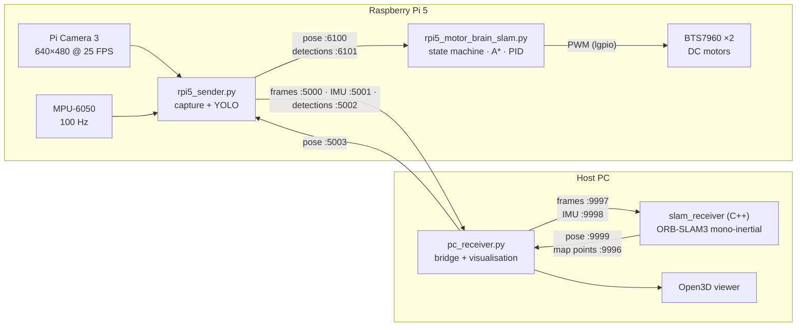
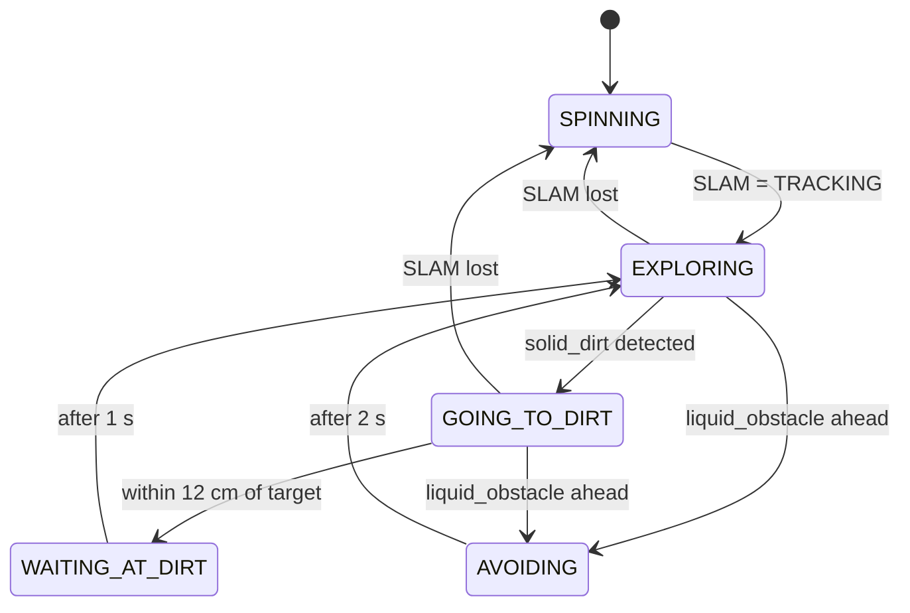

<p align="center">
  
</p>

<p align="center">
  <a href="LICENSE"></a>
  
  
  
  
  
</p>

<p align="center">
  <b>A low-cost differential-drive robot that maps a room with monocular visual-inertial SLAM,<br/>spots dirt with an on-board YOLO model, and drives to it using A* planning and PID control.</b>
</p>

<p align="center">
  <a href="#-demo">Demo</a> •
  <a href="#-how-it-works">How it works</a> •
  <a href="#-hardware">Hardware</a> •
  <a href="#-quick-start">Quick start</a> •
  <a href="#-configuration">Configuration</a> •
  <a href="docs/ARCHITECTURE.md">Architecture</a> •
  <a href="docs/HARDWARE.md">Wiring</a>
</p>

---

## ✨ Highlights

- **Visual-inertial SLAM** — ORB-SLAM3 in monocular-inertial mode, fed by a Pi Camera 3 (640×480 @ 25 FPS) and an MPU-6050 IMU (100 Hz).
- **Edge AI detection** — a custom YOLO model runs *on the Raspberry Pi 5* and recognises two classes: `solid_dirt` (drive to it) and `liquid_obstacle` (avoid it).
- **SLAM-aware behaviour** — the robot spins in place to initialise or recover tracking, sweeps the floor in a zig-zag (boustrophedon) pattern, and diverts to dirt as soon as it is seen.
- **Planning & control** — occupancy-grid A* planner (5 cm cells) with PID heading/speed control driving two BTS7960 H-bridges.
- **Live visualisation** — camera overlay with detections and SLAM state on the PC, plus an Open3D viewer for the growing 3-D map point cloud.
- **Edge + host split** — lightweight sensing, detection and motor control on the Pi; heavy SLAM on the PC, linked over UDP.

---

## 🎬 Demo

<table>
  <tr>
    <td align="center" width="50%">
      <br/>
      <sub><b>The robot</b> — Raspberry Pi 5, Pi Camera, MPU-6050, HC-SR04 and BTS7960 drivers</sub>
    </td>
    <td align="center" width="50%">
      <br/>
      <sub><b>Detection</b> — <code>solid_dirt</code> at 85 % confidence while SLAM initialises</sub>
    </td>
  </tr>
  <tr>
    <td align="center" width="50%">
      <br/>
      <sub><b>ORB-SLAM3</b> — tracked ORB features (top) and trajectory / keyframes (bottom)</sub>
    </td>
    <td align="center" width="50%">
      <br/>
      <sub><b>3-D map</b> — sparse point cloud rendered live in Open3D</sub>
    </td>
  </tr>
</table>

---

## 🧠 How it works



All links are UDP. The full port map and message formats are in [`docs/ARCHITECTURE.md`](docs/ARCHITECTURE.md).

### Behaviour state machine



While `SPINNING` (SLAM initialising or lost) the robot rotates slowly to give ORB-SLAM3 new features. Dirt seen during this phase is queued but not driven to until a valid pose is available.

---

## 🔧 Hardware

| Component | Part used | Notes |
|---|---|---|
| Compute | Raspberry Pi 5 | Runs capture, YOLO, navigation and motor control |
| Camera | Raspberry Pi Camera Module 3 | 640×480 @ 25 FPS via `picamera2` |
| IMU | MPU-6050 | I²C address `0x68`, 100 Hz |
| Motor drivers | 2 × BTS7960 | One per side, 1 kHz PWM |
| Drive | 2 × DC gear motors | Differential drive, 0.20 m wheel base |
| Ranging | HC-SR04 ultrasonic | Mounted on a servo at the front |
| Host | Linux PC | Runs ORB-SLAM3 and visualisation |

GPIO pin assignments and wiring notes: [`docs/HARDWARE.md`](docs/HARDWARE.md).

---

## 📁 Repository structure

```text
.
├── raspberry_pi/
│   ├── rpi5_sender.py             # Camera + IMU capture, on-board YOLO, UDP bridge
│   ├── rpi5_motor_brain_slam.py   # State machine, zig-zag explorer, A*, PID, motors
│   └── requirements.txt
├── pc/
│   ├── slam_receiver.cc           # ORB-SLAM3 monocular-inertial UDP front-end
│   ├── CMakeLists.txt             # Build template (links against ORB-SLAM3)
│   ├── pc_receiver.py             # Bridge Pi ⇄ SLAM, overlay, Open3D viewer
│   └── requirements.txt
├── imu_calibration/
│   └── imu_calibration_mpu6050.py # Six-position accel + gyro-bias calibration
├── calibration/
│   ├── webcam_fixed_v3.yaml       # ORB-SLAM3 camera + IMU settings
│   ├── camera_matrix.npy          # Camera intrinsics
│   └── README.md
├── models/                        # Put your YOLO weights here (not tracked)
├── docs/
│   ├── ARCHITECTURE.md            # Ports, message formats, data flow
│   └── HARDWARE.md                # Pin map and wiring
├── assets/                        # Banner and social-preview images
├── images/                        # Photos and result screenshots
└── LICENSES/                      # Third-party license notices
```

---

## 🚀 Quick start

### 1. Prerequisites

**Host PC (Ubuntu recommended)**
- [ORB-SLAM3](https://github.com/UZ-SLAMLab/ORB_SLAM3) built from source, with its dependencies (Pangolin, OpenCV, Eigen3)
- Python 3.9+ → `pip install -r pc/requirements.txt`

**Raspberry Pi 5 (Raspberry Pi OS Bookworm)**
```bash
sudo apt install -y python3-picamera2 python3-lgpio
pip install -r raspberry_pi/requirements.txt
```

### 2. Clone

```bash
git clone https://github.com/<your-username>/CleanBot_Autonomous_Robot.git
cd CleanBot_Autonomous_Robot
```

### 3. Build the SLAM receiver (PC)

```bash
mkdir -p pc/build && cd pc/build
cmake .. -DORB_SLAM3_DIR=$HOME/ORB_SLAM3
make -j4
```

### 4. Calibrate (Pi, once)

```bash
python3 imu_calibration/imu_calibration_mpu6050.py   # writes imu_calibration.json
```

Copy `imu_calibration.json`, `camera_matrix.npy`, `dist_coefficients.npy` and your YOLO model to the data directory on the Pi (default `/home/pi`, see [Configuration](#-configuration)).

### 5. Run — in this order

```bash
# PC, terminal 1 — SLAM
export LD_LIBRARY_PATH=$HOME/ORB_SLAM3/lib:/usr/local/lib:$LD_LIBRARY_PATH
./pc/build/slam_receiver $HOME/ORB_SLAM3/Vocabulary/ORBvoc.txt calibration/webcam_fixed_v3.yaml

# PC, terminal 2 — bridge + visualisation
CLEANBOT_RPI_IP=192.168.0.108 python3 pc/pc_receiver.py

# Pi, terminal 1 — sensors + YOLO
CLEANBOT_PC_IP=192.168.0.107 python3 raspberry_pi/rpi5_sender.py

# Pi, terminal 2 — navigation + motors
python3 raspberry_pi/rpi5_motor_brain_slam.py
```

If `lgpio` is not installed, the motor brain starts in **dry-run mode** and never drives the motors — useful for testing the pipeline on the bench.

### PC viewer keys

| Key | Action |
|---|---|
| `P` | Open / refresh the Open3D point-cloud viewer |
| `G` | Set a test goal 1 m ahead and plan a path |
| `O` | Mark an obstacle at the current position |
| `C` | Clear the current goal |
| `R` | Reset the map, dirt queue and navigator |
| `Q` | Quit |

---

## ⚙️ Configuration

| Setting | Where | Default |
|---|---|---|
| `CLEANBOT_PC_IP` | env var, read by `rpi5_sender.py` | `192.168.0.107` |
| `CLEANBOT_RPI_IP` | env var, read by `pc_receiver.py` | `192.168.0.108` |
| `CLEANBOT_DATA_DIR` | env var, read by `rpi5_sender.py` | `/home/pi` |
| Motor pins, wheel base, max speed | top of `rpi5_motor_brain_slam.py` | see [`docs/HARDWARE.md`](docs/HARDWARE.md) |
| Sweep leg length / width / speed | `SWEEP_*` in `rpi5_motor_brain_slam.py` | 1.5 m / 0.40 m / 0.15 m/s |
| Dirt-box size filter | `SMALL_DIRT_MODE`, `SMALL_BOX_*_AREA` | on, 400–12 000 px² |
| YOLO confidence | `rpi5_sender.py` | 0.45 |

`CLEANBOT_DATA_DIR` must contain `camera_matrix.npy`, `dist_coefficients.npy`, `imu_calibration.json` and `yolo_model26s.pkl`. Each file is optional — the sender logs `[--]` and continues without it.

---

## 🎯 Model

Trained weights are not committed (size and licensing). The code expects a pickled Ultralytics YOLO model named `yolo_model26s.pkl` with two classes:

| ID | Class | Robot response |
|---|---|---|
| 0 | `liquid_obstacle` | Turn away for 2 s |
| 1 | `solid_dirt` | Plan a path, drive to it, pause 1 s |

See [`models/README.md`](models/README.md) for what to document when adding weights.

---

## 📊 Suggested evaluation

| Area | Metrics |
|---|---|
| SLAM | ATE, RPE, tracking-loss rate, relocalisation success |
| Detection | Precision, recall, mAP, on-Pi inference latency |
| Navigation | Goal success rate, path length, time-to-target, final position error |
| Safety | Collisions / near misses, liquid-avoidance success |
| System | CPU / RAM on Pi and PC, network and end-to-end latency |

---

## ⚠️ Safety

This software drives real motors.

- Test at low speed in a clear area first, with the wheels off the ground for the very first run.
- Fit an easily reachable **hardware power cut-off**.
- Never leave the robot running unattended.
- Re-check camera and IMU calibration after changing the mounting.

---

## 🗺️ Roadmap

- [ ] Use the ultrasonic sensor in the obstacle-avoidance loop
- [ ] Persist and reload maps between runs
- [ ] Coverage tracking so already-cleaned cells are skipped
- [ ] ROS 2 wrapper
- [ ] Export the model to ONNX / NCNN for faster on-Pi inference

---

## 🤝 Contributing

Issues and pull requests are welcome — see [`CONTRIBUTING.md`](CONTRIBUTING.md).

---

## 📄 License

Original code in this repository is released under the [MIT License](LICENSE).

[ORB-SLAM3](https://github.com/UZ-SLAMLab/ORB_SLAM3) is an external dependency licensed under **GPLv3** and is not relicensed here — see [`LICENSES/ORB-SLAM3-LICENSE-NOTICE.txt`](LICENSES/ORB-SLAM3-LICENSE-NOTICE.txt). Note that distributing a binary that links ORB-SLAM3 (such as `slam_receiver`) is subject to GPLv3 terms.

---

## 👤 Author

**Raheeb Bin Nazmul**
Electrical & Electronic Engineering, North South University

*Interests: robotics · edge AI · embedded systems · computer vision · autonomous navigation*

If this project helps your work, please ⭐ the repo or cite it using [`CITATION.cff`](CITATION.cff).
